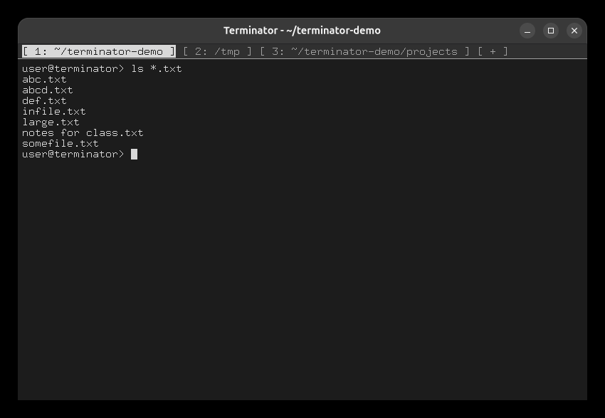
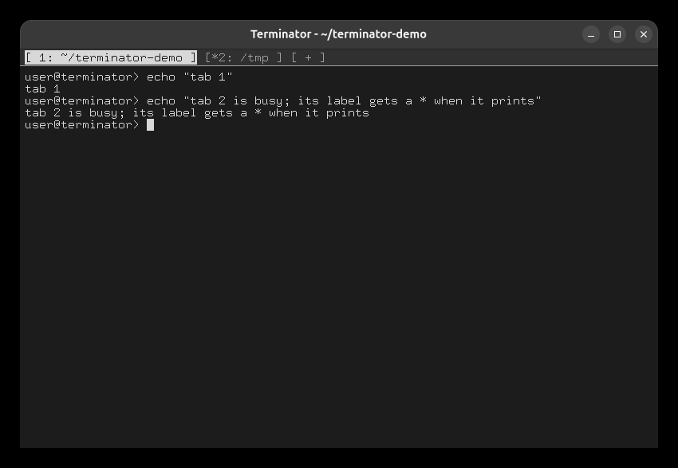

# Task 1: X11 GUI and tabs

## Several tabs, each with its own directory

```
ls *.txt
Ctrl+Shift+T                 # tab 2 opens in this tab's directory
cd /tmp
echo "tab 2 runs on its own"
Ctrl+Shift+T                 # tab 3
cd ~/terminator-demo/projects
Alt+1                        # back to tab 1
```

The tab bar shows each tab's directory. Tab 1's output is still there, because each tab keeps
its own scrollback. You can also click a tab, click `[ + ]`, middle-click a tab to close it, or
use Ctrl+Page_Up / Ctrl+Page_Down.



## A hidden tab keeps running

```
Ctrl+Shift+T
cd /tmp
sh -c "sleep 2; echo printed while hidden"
Alt+1                        # switch away while tab 2 is still running
```

After 2 seconds, tab 2 prints while hidden, and its label changes to `[*2: /tmp ]`.


