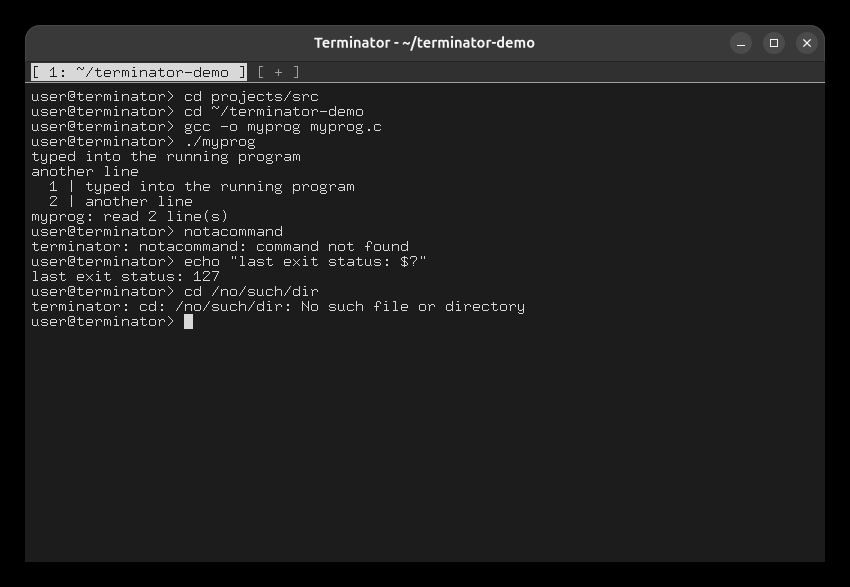
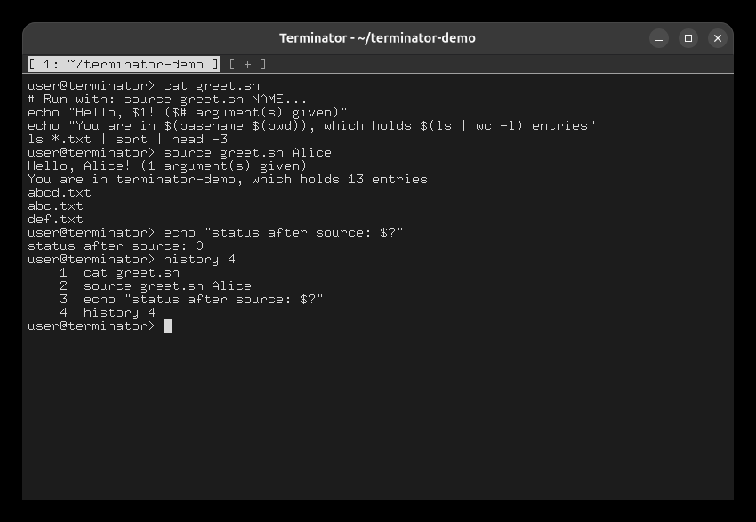

# Task 2: Built-in and external commands

## External commands, errors and `$?`

```
cd projects/src
cd ~/terminator-demo
gcc -o myprog myprog.c
./myprog
typed into the running program      ← typed while ./myprog runs
another line
Ctrl+D                              ← end of input
notacommand
echo "last exit status: $?"
cd /no/such/dir
```

- `./myprog` reads what you type. Each line is sent when you press Enter, and Ctrl+D ends the
  input.
- An unknown command prints `terminator: notacommand: command not found` and sets `$?` to 127.
- The tab stays usable after each error.



## `source`, `history`

```
cat greet.sh
source greet.sh Alice
echo "status after source: $?"
history 4
```

`source` runs the file's commands in this tab with `$1` = `Alice` and `$#` = 1. Command
substitution and pipes work inside the file.



The other required built-ins are demonstrated on their own pages: `multiWatch` in
[Task 6](task06-multiwatch.md), `jobs` / `fg` / `bg` in [Task 8](task08-jobs.md), and `exit`
(or Ctrl+D on an empty line) closes the tab.
