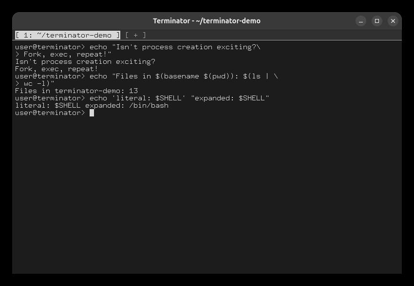
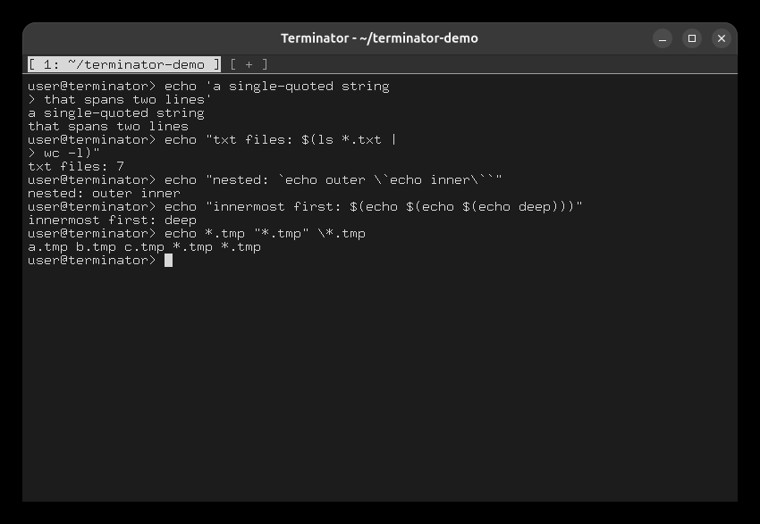

# Task 3: Multi-line input and quoting

## The examples from the specification

```
echo "Isn't process creation exciting?\
Fork, exec, repeat!"
echo "Files in $(basename $(pwd)): $(ls | \
wc -l)"
echo 'literal: $SHELL' "expanded: $SHELL"
```

Each incomplete line, ending in a backslash or inside an unclosed quote or `$(`, gets the `> `
continuation prompt.



## More cases

```
echo 'a single-quoted string
that spans two lines'
echo "txt files: $(ls *.txt |
wc -l)"
echo "nested: `echo outer \`echo inner\``"
echo "innermost first: $(echo $(echo $(echo deep)))"
echo *.tmp "*.tmp" \*.tmp
```

The cases cover:

- a quote spanning lines;
- a substitution spanning lines (a newline after `|` continues the pipeline);
- nested backticks;
- three levels of `$(...)`, run innermost first;
- globbing, with quoted and escaped patterns left as typed.


