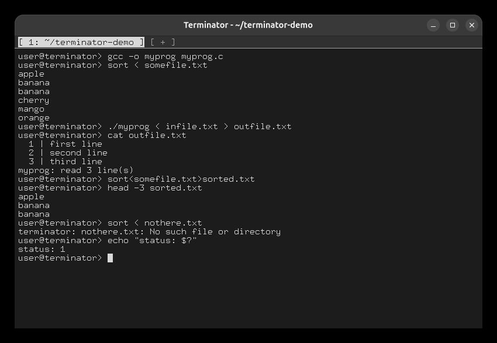
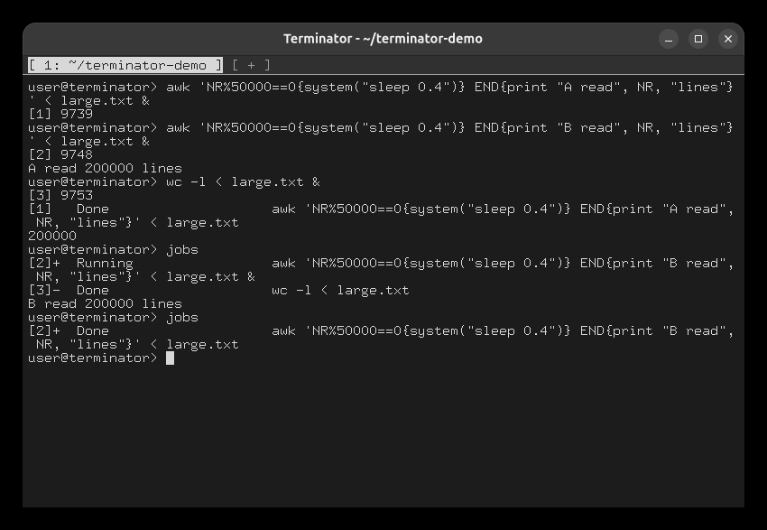

# Task 4: I/O redirection

## `<`, `>`, both, and a missing input file

```
gcc -o myprog myprog.c
sort < somefile.txt
./myprog < infile.txt > outfile.txt
cat outfile.txt
sort<somefile.txt>sorted.txt          # operators need no spaces
head -3 sorted.txt
sort < nothere.txt
echo "status: $?"
```

A missing input file is reported and the command is not run (`$?` = 1).



## Background jobs reading the same file

```
awk 'NR%50000==0{system("sleep 0.4")} END{print "A read", NR, "lines"}' < large.txt &
awk 'NR%50000==0{system("sleep 0.4")} END{print "B read", NR, "lines"}' < large.txt &
wc -l < large.txt &
jobs
jobs                                   # again, after about 2 seconds
```

The two `awk` readers pause while reading, so all three jobs read `large.txt` at the same time.
At the first `jobs`, reader B is still `Running`. Each reader opens the file itself, so each has
its own file offset, and every one of them sees all 200,000 lines.


