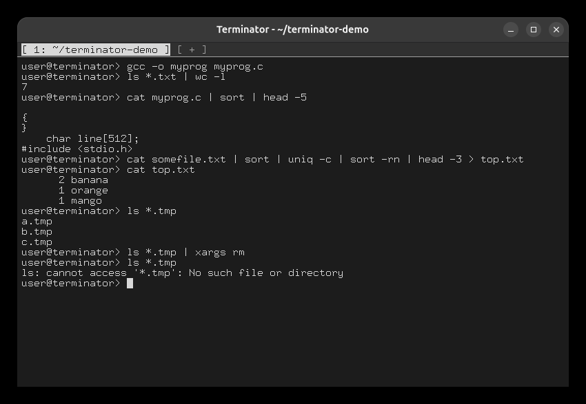
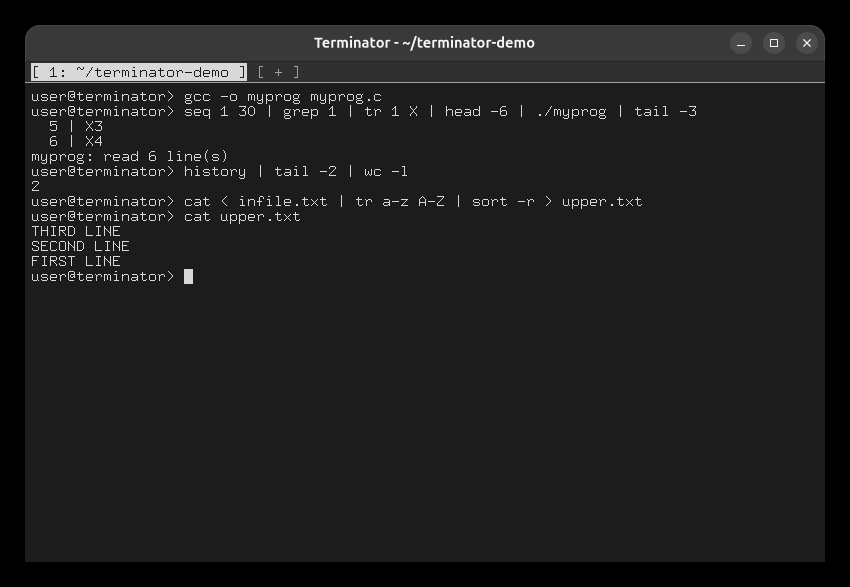

# Task 5: Pipes

## The examples from the specification

```
gcc -o myprog myprog.c
ls *.txt | wc -l
cat myprog.c | sort | head -5
cat somefile.txt | sort | uniq -c | sort -rn | head -3 > top.txt
cat top.txt
ls *.tmp
ls *.tmp | xargs rm
ls *.tmp                               # now an error: they are gone
```



Run `./tests/setup.sh` again to bring the `.tmp` files back.

## Longer pipelines

```
seq 1 30 | grep 1 | tr 1 X | head -6 | ./myprog | tail -3
history | tail -2 | wc -l              # a built-in inside a pipeline
cat < infile.txt | tr a-z A-Z | sort -r > upper.txt
cat upper.txt
```

The first line is 6 processes connected by 5 pipes. The others show a built-in inside a
pipeline, and redirection at both ends of a pipeline.


