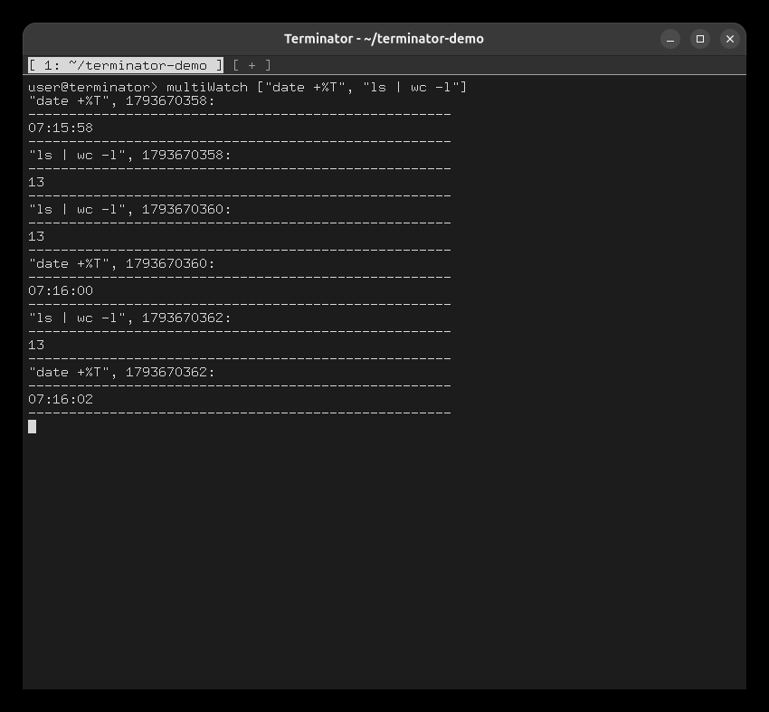
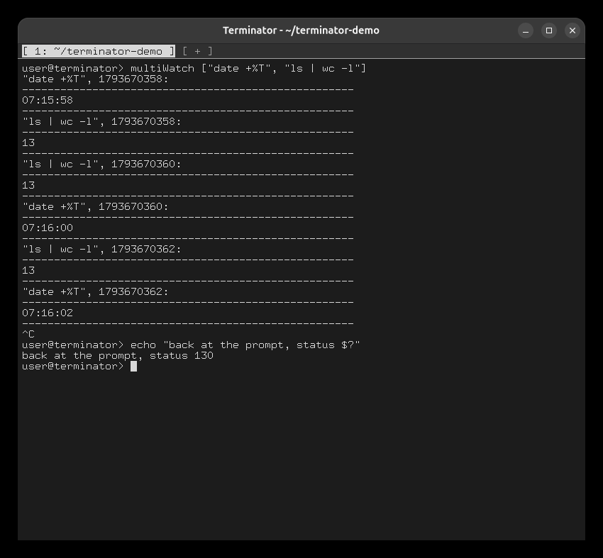

# Task 6: multiWatch

```
multiWatch ["date +%T", "ls | wc -l"]
Ctrl+C                                 ← after a few seconds
echo "back at the prompt, status $?"
```

Both commands run in parallel, each in its own process with its own pipe. Each output is printed
in the required format, with the Unix timestamp of the run, and each command is re-run every 2
seconds.



Ctrl+C kills every command, prints `^C`, and returns to the prompt with `$?` = 130.


