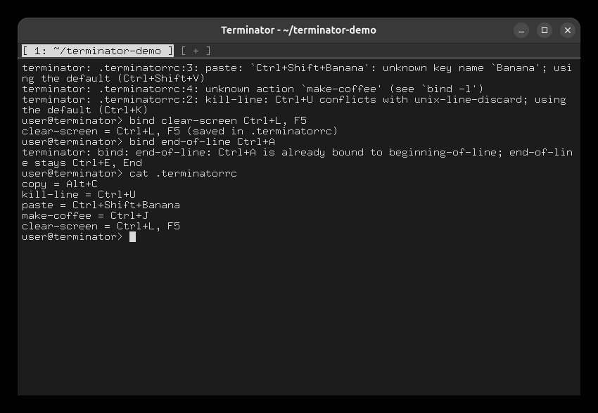
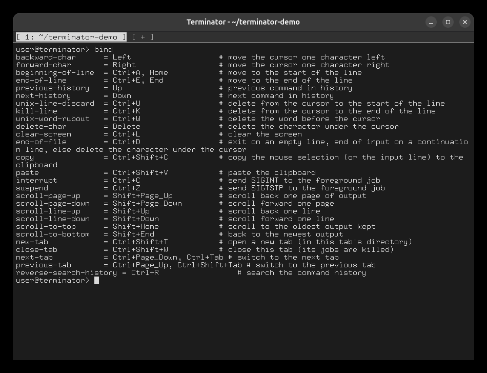

# Task 7: Hotkeys

## A config file with problems, and `bind`

Create a `~/.terminatorrc` with one valid binding and three bad ones, then start Terminator:

```
copy = Alt+C
kill-line = Ctrl+U
paste = Ctrl+Shift+Banana
make-coffee = Ctrl+J
```

At startup each problem is reported, and that action keeps its default:

- `Ctrl+U` already belongs to `unix-line-discard`, so it is a conflict;
- `Banana` is not a key name;
- `make-coffee` is not an action.

`copy = Alt+C` is accepted. Then:

```
bind clear-screen Ctrl+L, F5           # accepted and saved to the file
bind end-of-line Ctrl+A                # refused: Ctrl+A belongs to beginning-of-line
cat ~/.terminatorrc
```

The new binding is in the file, so it is still there after a restart. No recompiling is needed.



(This run was started with `TERMINATORRC=.terminatorrc ./terminator`, so the messages show a
short file name.)

## Every action and its keys

```
bind
```



To try the editing keys, type a line and use ← / →, Ctrl+A / Ctrl+E, Ctrl+U / Ctrl+K, Ctrl+W,
↑ / ↓ and Ctrl+L. To copy and paste, select text with the mouse and press Ctrl+Shift+C, then
Ctrl+Shift+V.
