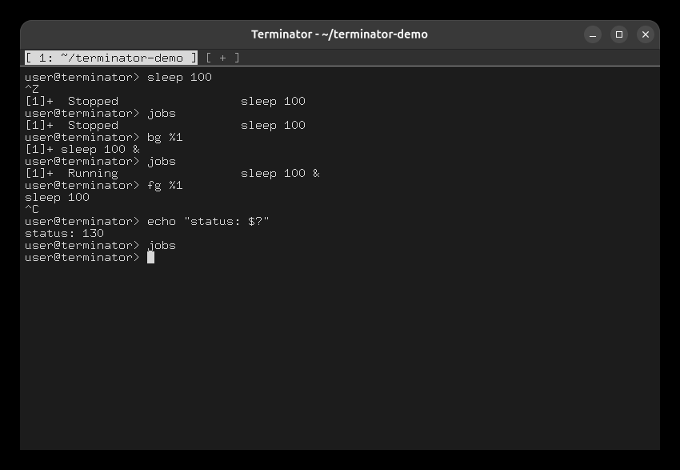
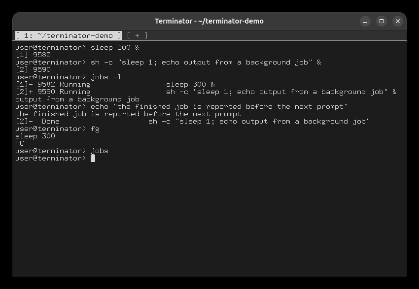

# Task 8: Signals and job control

## The example from the specification

```
sleep 100
Ctrl+Z
jobs
bg %1
jobs
fg %1
Ctrl+C
echo "status: $?"
jobs
```



## Background jobs

```
sleep 300 &
sh -c "sleep 1; echo output from a background job" &
jobs -l
echo "the finished job is reported before the next prompt"    ← after about 2 seconds
fg
Ctrl+C
jobs
```

- A background job's output appears while you keep working.
- When a job finishes, `Done` is reported just before the next prompt, as in bash.
- `fg` with no argument takes the current job (`+`).


