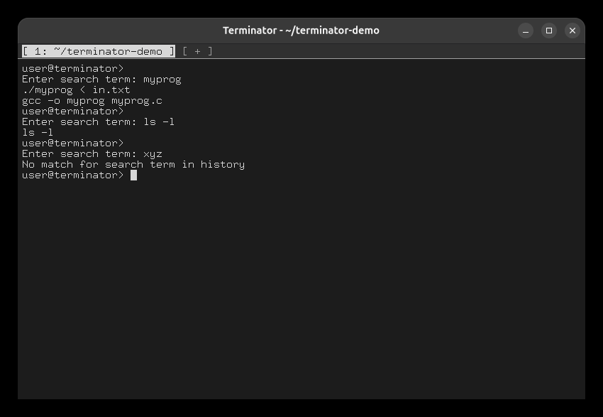
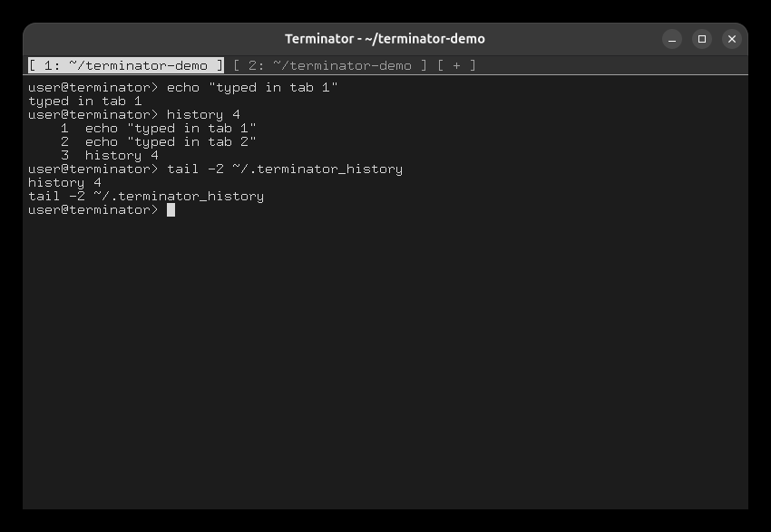

# Task 9: Searchable history

## Ctrl+R

This history file was used for the run (`~/.terminator_history`, oldest first):

```
ls -l
gcc -o myprog myprog.c
./myprog < in.txt
cat somefile.txt | sort
```

```
Ctrl+R   then type: myprog    Enter    → no exact match: both commands sharing "myprog", newest first
Ctrl+R   then type: ls -l     Enter    → the exact match
Ctrl+R   then type: xyz       Enter    → No match for search term in history
```



## One history shared by all tabs (process mode)

Start with `./terminator useProcess=True`, so each tab is a separate process:

```
echo "typed in tab 1"
Ctrl+Shift+T
echo "typed in tab 2"                  ← in tab 2
Alt+1
history 4                              ← back in tab 1: tab 2's command is there
tail -2 ~/.terminator_history          ← the history file is updated at once
```


