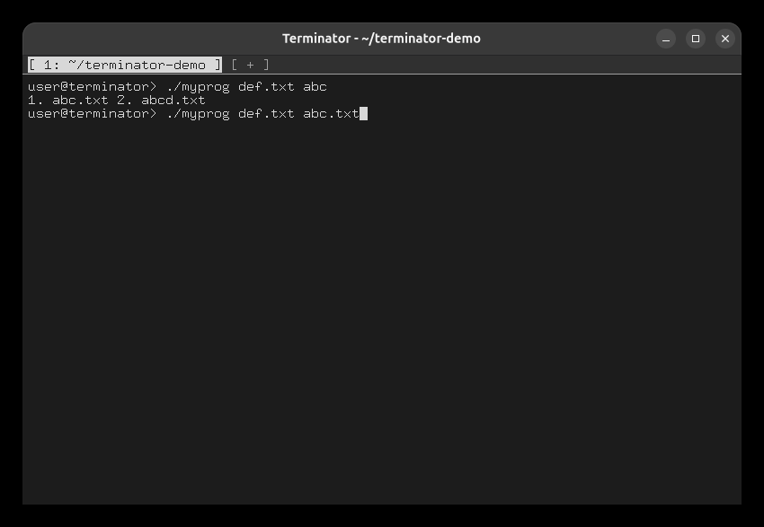
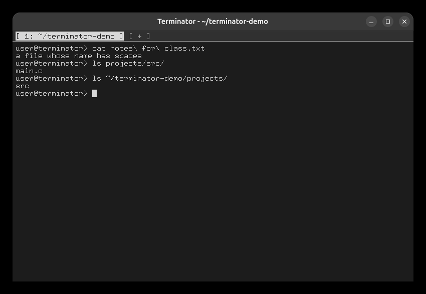

# Task 10: File-name completion

## The example from the specification

```
./myprog de      Tab   → ./myprog def.txt
 abc             Tab   → shows "1. abc.txt 2. abcd.txt"
1                      → ./myprog def.txt abc.txt
```



## Spaces, directories, `~`

```
cat no           Tab   → cat notes\ for\ class.txt      (spaces escaped)        Enter
ls proj          Tab   → ls projects/
s                Tab   → ls projects/src/                (directories get a /)    Enter
ls ~/termi       Tab   → ls ~/terminator-demo/
p                Tab   → ls ~/terminator-demo/projects/                          Enter
```



With no match, Tab does nothing. The rest of the line is never changed, even if the command does
not exist.
